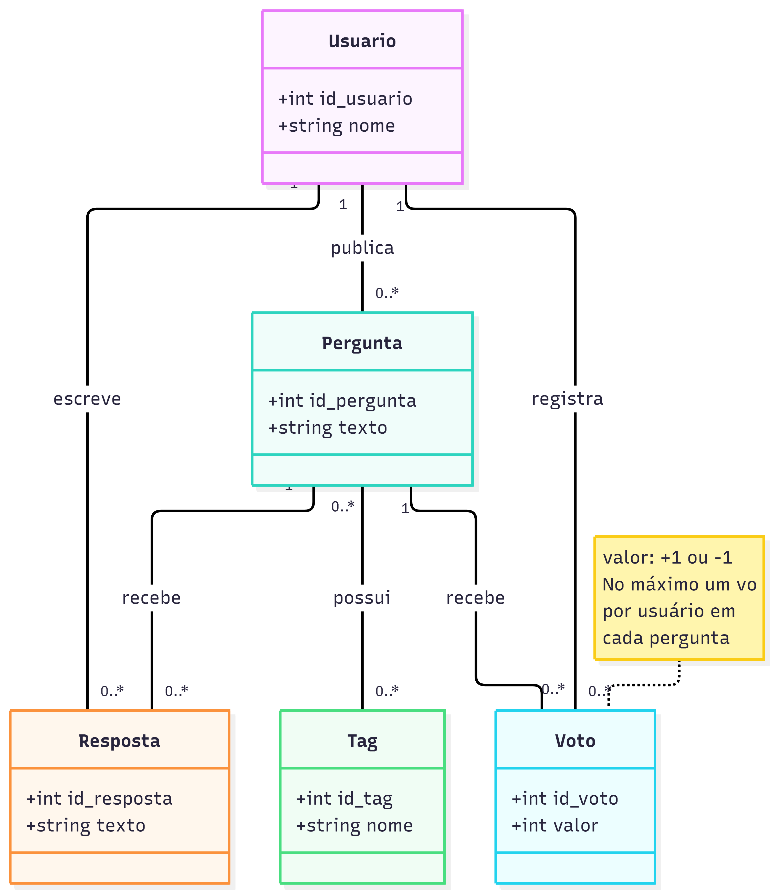
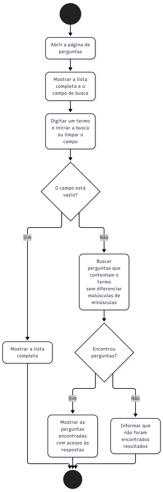
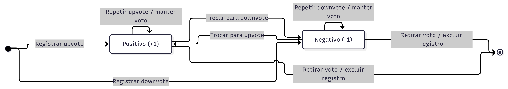

# Projeto final de Engenharia de Software

O projeto usa o ESM Forum, um fórum de perguntas e respostas com backend em Node.js, Express e SQLite e frontend em React. Esta pasta reúne os documentos e diagramas da entrega. O código fica nos repositórios abaixo.

## Repositórios e planejamento

- [Backend — esmforum](https://github.com/matheusmi2/esmforum)
- [Frontend — esmforum-react](https://github.com/matheusmi2/esmforum-react)
- [Quadro Kanban no GitHub Projects](https://github.com/users/matheusmi2/projects/5)

## Parte 1 — Ambiente e planejamento

A pasta parte1 contém as instruções para executar o sistema, a escolha do processo de desenvolvimento e os documentos sobre as práticas de XP.

- [INSTALACAO.md](parte1/INSTALACAO.md): instalação e execução do backend e do frontend.
- [PROCESSO.md](parte1/PROCESSO.md): escolha do Kanban, colunas e prioridades.
- [DESIGN_SIMPLES.md](parte1/DESIGN_SIMPLES.md): análise do backend com exemplos de código e possíveis melhorias.
- [PAIR_PROGRAMMING.md](parte1/PAIR_PROGRAMMING.md): planejamento das sessões, ferramentas e troca de papéis.

## Parte 2 — Requisitos e diagramas UML

A pasta parte2 contém as histórias de votação, busca e tags, o caso de uso da votação e os quatro diagramas. Cada imagem tem seu arquivo fonte Mermaid na mesma pasta.

- [HISTORIAS.md](parte2/HISTORIAS.md): três histórias com critérios de aceitação e justificativa da prioridade.
- [CASO_DE_USO.md](parte2/CASO_DE_USO.md): votação em perguntas, com os caminhos para trocar e retirar o voto.

### Diagrama de classes

Mostra Usuario, Pergunta, Resposta, Voto e Tag, com seus atributos e relacionamentos.

[Arquivo fonte Mermaid](parte2/diagramas/diagrama_classes.mmd)

### Diagrama de sequência

Mostra a comunicação entre usuário, frontend, API e banco durante a votação.

[Arquivo fonte Mermaid](parte2/diagramas/diagrama_sequencia.mmd)

### Diagrama de atividades

Mostra os passos da busca por palavra-chave e as decisões sobre campo vazio e resultados encontrados.

[Arquivo fonte Mermaid](parte2/diagramas/diagrama_atividades.mmd)

### Diagrama de estados

Mostra os estados do voto e o que acontece ao registrar, trocar, repetir ou retirar um voto.

[Arquivo fonte Mermaid](parte2/diagramas/diagrama_estados.mmd)

## Parte 3 — SOLID, padrões de projeto e arquitetura

A [análise SOLID](parte3/ANALISE_SOLID.md) apresenta três pontos positivos e duas oportunidades de melhoria no backend. A [implementação da votação](parte3/IMPLEMENTACAO_SOLID.md) inclui o código nos repositórios do backend e do frontend, exemplos de SOLID e os testes realizados. A [análise dos padrões existentes](parte3/PADROES_EXISTENTES.md) descreve Strategy, DAO e as funções de fábrica. As [propostas de padrões](parte3/PADROES_PROPOSTOS.md) trazem três diagramas, exemplos de código e a aplicação prevista no fórum. Os documentos de arquitetura ainda estão pendentes. A [lista de entregáveis da Parte 3](parte3/README.md) indica o que falta.

## Organização das cópias

Os documentos das partes 1 e 2 e os diagramas foram copiados da versão e0abadb do repositório do backend. Os arquivos originais continuam no repositório esmforum. As revisões locais dos documentos da Parte 1 que não foram commitadas ficaram fora desta cópia. A pasta parte3 reúne os novos documentos conforme forem preparados.

Para executar o sistema, use os repositórios indicados no início e siga o guia de instalação da Parte 1.
